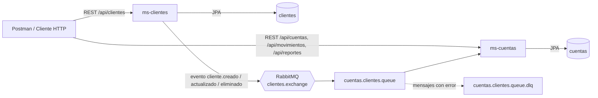

# Banco: microservicios

Hay dos microservicios en Java 21 y Spring Boot 4.1, con Clean Architecture, JPA/Hibernate y PostgreSQL. Se comunican de forma asíncrona por RabbitMQ y todo se ejecuta en Docker.

| Microservicio | Agrupa | Puerto | Base de datos |
|---------------|--------|--------|---------------|
| `ms-clientes` | Persona, Cliente | 8081 | `clientes` |
| `ms-cuentas` | Cuenta, Movimiento, Reportes | 8082 | `cuentas` |

## Arquitectura



- **Comunicación asíncrona.** Cada vez que se crea, actualiza o elimina un cliente, `ms-clientes` publica un evento después del commit. `ms-cuentas` lo consume y guarda una réplica local (`cliente_snapshot`). Con esa réplica valida la apertura de cuentas y obtiene el nombre del cliente para el reporte, sin hacer llamadas síncronas entre servicios. Si `ms-clientes` cae, `ms-cuentas` sigue operando.
- **Capas de Clean Architecture en cada servicio:**
  - `domain`: modelo puro, reglas de negocio, puertos y excepciones. No depende de Spring ni de JPA.
  - `application`: casos de uso, servicios transaccionales, DTOs y mappers.
  - `infrastructure`: entidades JPA, repositorios, adaptadores, mensajería y configuración.
  - `presentation`: controladores REST y manejo global de errores.
- **Patrones:**
  - Repository y Ports & Adapters, para el acceso a datos y la mensajería.
  - Builder, para `Cliente`.
  - Factory methods, como `Cuenta.abrir` y `Cuenta.reconstruir`.
  - Value Object, con `RangoFechas`.
  - Agregado raíz: `Cuenta` es la única forma de cambiar un saldo.
  - Publisher/Subscriber, para los eventos.

## Ejecución con Docker

Requisitos: Docker Desktop.

```bash
docker compose up --build -d
```

Los microservicios quedan disponibles en:

- ms-clientes: http://localhost:8081/api/clientes
- ms-cuentas: http://localhost:8082/api/cuentas

`BaseDatos.sql` se ejecuta automáticamente la primera vez que arranca PostgreSQL: crea las bases `clientes` y `cuentas`, sus tablas y los datos iniciales.

Para empezar desde cero (por ejemplo, después de cambiar `BaseDatos.sql`), elimina los volúmenes y vuelve a levantar:

```bash
docker compose down -v
```

```bash
docker compose up --build -d
```

### Ejecución local (sin Docker para los microservicios)

Los `application.yaml` leen la configuración de variables de entorno con valores por defecto para desarrollo local:

| Variable | Valor por defecto |
|----------|-------------------|
| `DB_URL` | `jdbc:postgresql://localhost:5433/clientes` (o `cuentas`) |
| `DB_USER` / `DB_PASSWORD` | `postgres` / `postgres` |
| `RABBITMQ_HOST` / `RABBITMQ_PORT` | `localhost` / `5672` |
| `RABBITMQ_USER` / `RABBITMQ_PASSWORD` | `guest` / `guest` |

Las credenciales de servicios externos (por ejemplo, un RabbitMQ en la nube) se pasan como variables de entorno y nunca se guardan en el repositorio.

## Pruebas

Las pruebas usan H2 en memoria, así que no necesitan Docker:

```bash
cd ms-clientes && mvn test
```

```bash
cd ms-cuentas && mvn test
```

- **F5:** `ms-clientes/src/test/java/com/banco/ms/clientes/domain/model/ClienteTest.java` es la prueba unitaria de la entidad de dominio Cliente.
- **F6:** `ms-cuentas/src/test/java/com/banco/ms/cuentas/MovimientoIntegrationTest.java` es la prueba de integración. Recorre el flujo completo dentro del microservicio: cliente sincronizado, apertura de cuenta, depósito (F2), retiro sin saldo "Saldo no disponible" (F3) y reporte de estado de cuenta (F4).

## Datos iniciales

`BaseDatos.sql` precarga estos clientes y cuentas:

| Cliente | clienteId | Cuentas |
|---------|-----------|---------|
| José Lema | `8F3A2C1D9E4B4F6A8C7D1E2F3A4B5C6D` | 478758 (Ahorros, 2000) |
| Marianela Montalvo | `1B2C3D4E5F6A47B8C9D0E1F2A3B4C5D6` | 225487 (Corriente, 100), 496825 (Ahorros, 540) |
| Juan Osorio | `9A8B7C6D5E4F43A2B1C0D9E8F7A6B5C4` | 495878 (Ahorros, 0) |

Los casos 3, 4 y 5 se ejecutan contra la API (ver los ejemplos de abajo).

## Endpoints

| Verbo | Endpoint | Descripción |
|-------|----------|-------------|
| GET | `/api/clientes` | Lista clientes |
| GET | `/api/clientes/{clienteId}` | Obtiene un cliente |
| POST | `/api/clientes` | Crea un cliente (201 + `Location`). El `clienteId` lo genera el servidor |
| PUT | `/api/clientes/{clienteId}` | Reemplaza los datos del cliente |
| PATCH | `/api/clientes/{clienteId}` | Actualiza parcialmente al cliente |
| DELETE | `/api/clientes/{clienteId}` | Elimina al cliente (204) y desactiva sus cuentas por evento |
| GET | `/api/cuentas?clienteId=` | Lista cuentas, con filtro opcional por cliente |
| GET | `/api/cuentas/{numeroCuenta}` | Obtiene una cuenta |
| POST | `/api/cuentas` | Abre una cuenta |
| PUT | `/api/cuentas/{numeroCuenta}` | Actualiza el tipo y el estado |
| PATCH | `/api/cuentas/{numeroCuenta}` | Actualiza parcialmente el tipo o el estado |
| GET | `/api/movimientos?numeroCuenta=` | Lista movimientos, con filtro opcional por cuenta |
| GET | `/api/movimientos/{id}` | Obtiene un movimiento |
| POST | `/api/movimientos` | Registra un movimiento (valor `+` depósito, `-` retiro) |
| PUT | `/api/movimientos/{id}` | Corrige el valor del último movimiento de la cuenta |
| GET | `/api/reportes?fecha=yyyy-MM-dd,yyyy-MM-dd&cliente={clienteId}` | Estado de cuenta (JSON) |

### Ejemplos

Crear un cliente (`POST http://localhost:8081/api/clientes`):

```json
{
  "nombre": "Ana Pérez",
  "genero": "FEMENINO",
  "edad": 28,
  "identificacion": "1745678901",
  "direccion": "Av. 10 de Agosto y Colón",
  "telefono": "099123456",
  "contrasena": "abcd",
  "estado": true
}
```

Caso 3: abrir la cuenta corriente de José Lema (`POST http://localhost:8082/api/cuentas`):

```json
{
  "numeroCuenta": "585545",
  "tipoCuenta": "CORRIENTE",
  "saldoInicial": 1000,
  "estado": true,
  "clienteId": "8F3A2C1D9E4B4F6A8C7D1E2F3A4B5C6D"
}
```

Caso 4: movimientos (`POST http://localhost:8082/api/movimientos`):

```json
{ "numeroCuenta": "478758", "valor": -575 }
```

```json
{ "numeroCuenta": "225487", "valor": 600 }
```

```json
{ "numeroCuenta": "495878", "valor": 150 }
```

```json
{ "numeroCuenta": "496825", "valor": -540 }
```

F3: un retiro sin saldo suficiente responde `422` con `"message": "Saldo no disponible"`:

```json
{ "numeroCuenta": "496825", "valor": -1 }
```

Caso 5: estado de cuenta de Marianela Montalvo:

```
GET http://localhost:8082/api/reportes?fecha=2024-01-01,2030-12-31&cliente=1B2C3D4E5F6A47B8C9D0E1F2A3B4C5D6
```

### Manejo de errores

Todas las respuestas de error usan el mismo formato:

```json
{
  "timestamp": "2026-10-26T10:15:30",
  "status": 422,
  "error": "Unprocessable Entity",
  "message": "Saldo no disponible",
  "path": "/api/movimientos",
  "details": []
}
```

| Situación | HTTP |
|-----------|------|
| Datos de entrada inválidos (Bean Validation o reglas de formato) | 400 |
| Recurso inexistente | 404 |
| Recurso duplicado o bloqueo concurrente | 409 |
| Regla de negocio, incluido F3 **"Saldo no disponible"** | 422 |
| Error inesperado (sin stack trace al cliente) | 500 |

## Decisiones y supuestos

1. **Broker.** Se usa RabbitMQ con un topic exchange, una cola durable y una dead-letter queue.
2. **`clienteId`.** Es una clave de negocio única, distinta de la PK técnica (`persona.id`), que **genera el servidor** como un UUID de 32 caracteres alfanuméricos. Se devuelve en la respuesta y en el header `Location`. La `identificacion` de la persona también es única.
3. **Herencia.** `Cliente` hereda de `Persona` tanto en el dominio como en JPA (`InheritanceType.JOINED`).
4. **Contraseñas.** Se guardan con BCrypt y nunca se devuelven en las respuestas.
5. **Número de cuenta.** Lo envía el consumidor de la API al abrir la cuenta.
6. **Movimientos con signo.** Un valor positivo es un depósito y uno negativo, un retiro. `tipoMovimiento` se deriva del signo.
7. **Saldos.** `saldoInicial` no cambia después de abrir la cuenta. `saldoDisponible` solo cambia mediante movimientos, y cada movimiento guarda el saldo que dejó en la cuenta.
8. **Corrección de movimientos (PUT).** Solo se permite sobre el último movimiento de la cuenta, para que el historial de saldos siga siendo coherente.
9. **Clientes eliminados.** Al eliminar un cliente, sus cuentas se desactivan en lugar de borrarse, para conservar el historial de transacciones.
10. **Rango de fechas.** El formato es `yyyy-MM-dd,yyyy-MM-dd`, inclusivo en ambos extremos. Una sola fecha consulta un único día.

## Rendimiento, escalabilidad y resiliencia

- **Concurrencia.** Cada movimiento bloquea la fila de la cuenta (`PESSIMISTIC_WRITE`) dentro de una transacción, así dos retiros simultáneos no pueden dejar el saldo negativo. Además, la base tiene un `CHECK (saldo_disponible >= 0)` como segunda barrera.
- **Rendimiento.** Hay índices en `cuenta(cliente_id)` y `movimiento(cuenta_id, fecha)`. El reporte se resuelve con dos consultas (`join fetch`, sin N+1), y `open-in-view` está desactivado.
- **Escalabilidad.** Los servicios no guardan estado, así que pueden escalar horizontalmente detrás de un balanceador. Cada servicio tiene su propia base de datos, y varios consumidores pueden compartir la cola.
- **Resiliencia.** No hay acoplamiento temporal entre los servicios. El consumidor es idempotente (upsert por `clienteId`) y descarta eventos desordenados por fecha. Los mensajes que fallan van a una dead-letter queue en lugar de perderse.
- **Mejoras futuras.**
  - Patrón Transactional Outbox, para garantizar la publicación de eventos ante una caída del broker.
  - Paginación en los listados.
  - Autenticación con OAuth2/JWT.
  - Trazas distribuidas con Micrometer Tracing.
  - Migraciones versionadas con Flyway.
  - Pruebas de integración con Testcontainers sobre un PostgreSQL real.
